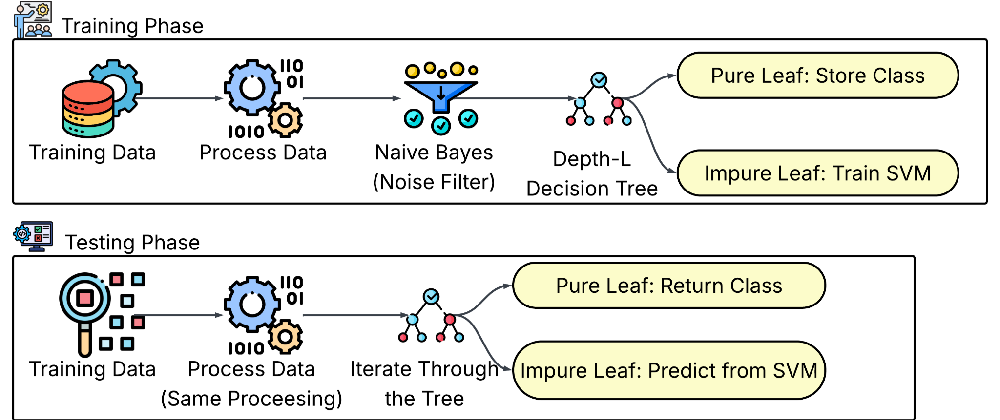

# SVMTree

SVMTree: a hybrid decision tree and Support Vector Machine classifier with Naïve Bayes noise filtering.


## Idea

A decision tree overfits noisy labels. A kernel SVM is accurate, but its training time grows faster than linearly with the number of instances. SVMTree combines them in three steps:

1. **Noise filter.** A Gaussian Naïve Bayes model predicts every training instance with cross-validated predictions. Instances whose label disagrees with the prediction are suspects. The ones with the lowest probability for their given label are removed, up to a cap (a fraction of the training set).
2. **Shallow decision tree.** A depth-limited CART tree splits the cleaned data into leaves.
3. **Local SVMs.** A pure leaf predicts its class. A leaf with more than one class and enough instances gets its own RBF SVM.

A new instance is routed down the tree, and its leaf returns the class or asks its SVM.




## Setup

```
python -m venv .venv
source .venv/bin/activate        # Windows: .venv\Scripts\activate
pip install -r requirements.txt
```

The datasets are downloaded when the scripts run (GitHub copies of the UCI files, and the Breast Cancer data from scikit-learn), so an internet connection is needed.

## Usage

Run all experiments (about 10 minutes on one CPU):

```
python scripts/run_experiments.py
```

A short test run:

```
python scripts/run_experiments.py --quick --out results_quick
```

Redraw the figures from the saved tables:

```
python scripts/make_figures.py
```

Use the classifier on its own:

```python
from sklearn.pipeline import make_pipeline
from sklearn.preprocessing import StandardScaler
from svmtree import SVMTree

model = make_pipeline(StandardScaler(), SVMTree(max_depth=2, noise_cap=0.10, C=1.0))
model.fit(X_train, y_train)
pred = model.predict(X_test)
```

`SVMTree` parameters: `max_depth` (tree depth), `noise_cap` (largest fraction of training instances the filter may remove, 0 turns it off), `C` and `gamma` (leaf SVMs), `min_leaf` (minimum instances per tree leaf), `min_svm` (minimum instances for a leaf to get an SVM), `local="none"` (leaves predict their majority class, no SVMs).


## Data and license

The datasets belong to the UCI Machine Learning Repository (https://archive.ics.uci.edu). Please check the license on each dataset page and cite the repository: Dua, D. and Graff, C. (2017), UCI Machine Learning Repository.

MIT License. 

## Author

Niful Islam
